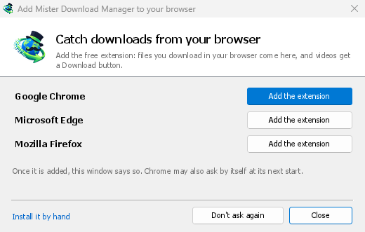
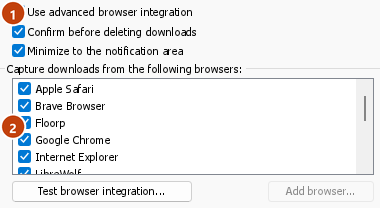
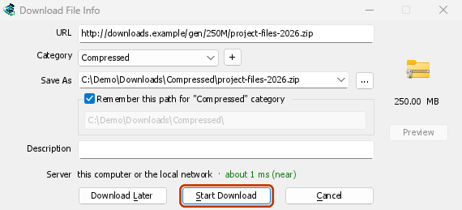
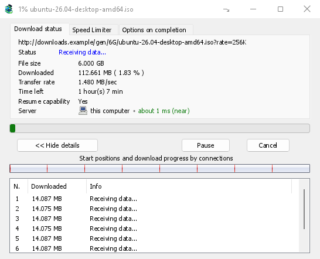
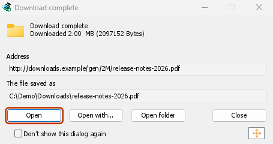
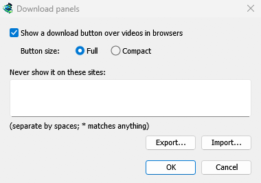
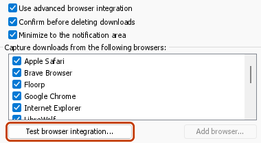

# Browser integration

[← Back to docs index](README.md)

With the ODM extension, clicking a download link in your browser hands the download to ODM. ODM gets the address together with the page it came from (the referrer), your cookies for the site and the browser's User-Agent, so downloads that need you to be signed in still work. It also gets the address the browser's own download had reached: when a site refuses ODM the link itself (a one-time link the browser has already used, or a site that lets only browsers ask for its links), ODM goes on from there once, without your cookies if it is another site. When a site's bot check (Cloudflare's, for one) or its refusal of programs (FileHippo's *412 Precondition Failed*) turns ODM's own connection away, ODM asks once more connecting the way your browser does (the same handshake, settings and order of headers), with your browser's User-Agent and its cookies for that site only, and downloads on it with as many connections as any download, each asking for its part of the file (on one connection when the site refuses parts there); your proxy, network adapter and speed limits apply as usual. The pieces of a video stream (HLS, DASH) go the same way when the site's check refuses them. Some checks (SourceForge's) refuse anything that calls itself a browser without connecting exactly like one, and let a program that says what it is through: when that connection is refused too, ODM asks once more under its own name (`OrbitDownloadManager/` and its version, or the User-Agent you typed in **Options → Downloads**), with the same cookies and referrer, and remembers the site until ODM closes, so its next downloads, and a paused one when it resumes, go that way at once. It solves no challenge: a site that still wants one answered (some Cloudflare checks ask it of every visitor, for the site's pages too) refuses again, and ODM says *this site lets only browsers through*; Alt+click the link to leave the download to the browser.

The extension works in **Google Chrome**, **Microsoft Edge**, **Brave**, **Opera** and **Vivaldi**, in **Firefox** 140 or later, and in **Safari** 17 or later on a Mac (see [Safari](#safari-macos)).

Browsers built on them work too: Chromium and Helium take the extension as Chrome does, Brave Origin as Brave does, Zen and LibreWolf as Firefox does. On Windows, Zen has a bug of its own (see [The browser and ODM aren't connected](browser-help.md#not-installed)).

## Set it up

Browser integration has two parts: a small helper program that the browser talks to, and the extension itself.

1. Install ODM with the setup and keep **Set up browser integration (Chrome, Edge, Brave, Firefox)** ticked. This registers the helper. (The portable copy can't do this; see [Portable mode](portable.md).)
2. Add the extension to each browser you use, as below: Firefox from its add-ons store, the others from the Chrome Web Store. Until a browser's extension has reached ODM, ODM's **Add Orbit Download Manager to your browser** window opens at each start: it lists the browsers it found, and **Add the extension** opens the store's page in that browser. **Install it by hand** opens the steps for loading it without the store; **Don't ask again** stops the window.

*ODM's own window opens each browser's store page for you.*

### Firefox

Install Orbit’s extension from the [latest release](https://github.com/mthlpbs/Orbit-Download-Manager/releases/latest). Orbit has no browser store listing yet.

### Chrome, Edge, Brave, Opera and Vivaldi

Install Orbit’s extension from the [latest release](https://github.com/mthlpbs/Orbit-Download-Manager/releases/latest). Orbit has no browser store listing yet.

To load it by hand instead (a browser that can't use the store, or a build of your own): its files are in the `extension` folder where ODM is installed: `%LOCALAPPDATA%\Programs\Orbit Download Manager\extension` if you installed it for yourself, or `Program Files\Orbit Download Manager\extension` if you installed it for everyone. Every release also has them as their own download, `...-extension-chromium.zip` (unzip it first).

1. Open the extensions page: `chrome://extensions`, `edge://extensions` or `brave://extensions`.
2. Turn on **Developer mode**.
3. Click **Load unpacked** and choose the `extension\chromium` folder.

**Orbit Download Manager** appears in the list. Leave it turned on. Pin its button to the toolbar to see at a glance whether the browser reaches ODM.

### Helium

[Helium](https://helium.computer/) installs the extension from the same page in the Chrome Web Store: click **Add to Chrome**. Helium fetches extensions through its own services, so this works only while they're allowed. If Helium says **Extension downloads are disabled**, open `helium://settings/privacy/services` (**Settings → Privacy and security → Helium services**), turn on **Allow connecting to Helium services** and **Proxy extension downloads and updates**, and click **Add to Chrome** again. With those off, load the extension by hand instead, as above (`chrome://extensions` works in Helium too).

Orbit’s Windows installer registers the browser helper. Load the Orbit Chromium extension unpacked in Helium.

## What it takes

When you click a download, the extension checks ODM's Options:

- **Options → General → Use advanced browser integration** must be on. Turn it off to send nothing to ODM.
- **Options → General → Capture downloads from the following browsers** must have your browser ticked.
- **Options → File types → Automatically start downloading the following file types** must list the file's type. The list starts with the usual ones: ZIP, RAR, 7Z, EXE, MSI, ISO, DMG, DEB, RPM, APPIMAGE, MP3, MP4, MKV, WEBM, PDF, AI models such as GGUF and SAFETENSORS, 3D files such as GLB and STL, and many more. Anything else can be added to the list.
- **Options → File types → Don't start downloading automatically from the following sites** must not list the site. Names are separated by spaces; a name covers its subdomains (`example.com` covers `www.example.com`, as `*.update.microsoft.com` covers `dl.update.microsoft.com`; `*` matches anything, as in `*.example.*`), and the files the site's pages link to on another server (a CDN), told by the page the download came from (its referrer). **Edit list ...** below it lists whole addresses to leave alone, one per line (`https://example.com/private/*`).
- **Options → File types → Don't take files smaller than** leaves small files (a receipt, an icon) to the browser. 0 takes any size.
- A `.torrent` file goes to ODM only while **Tasks → Torrent settings → Open magnet links and .torrent files with Orbit Download Manager** is on. Off, the browser keeps it and opens it in your own torrent program. See [Torrents](torrents.md#add-a-torrent).
- The extension must be allowed to read the site. When you limit it to some sites (or **On click**), it can't pass your sign-in on, so it leaves those sites' downloads to the browser.

*1 must be on, and 2 your browser ticked.*

When the browser keeps a download, the extension's button says which of these left it there, with the file's name, and ODM's log has a line for each one (`logs\odm.log` in [ODM's data folder](crash-reports.md#where-reports-are-kept)).

Both the address you clicked and the one its redirects led to are checked, so a site you excluded stays excluded even when it sends you to another server. Everything else stays with the browser. Changes in Options reach the browser within a minute; you don't need to restart it.

When ODM takes a download, it gets the browser's file name, size and type with it, so **Download File Info** shows them at once without asking the server again. A download from a form (a button that posts and gets a file back) is posted again by ODM with the form's data; a form that sends a file stays with the browser.

When ODM takes a download, the browser's own copy is cancelled and removed from the browser's download list. In Firefox and the browsers built on it (Waterfox, Zen, LibreWolf), ODM takes it as soon as the server answers, before the browser asks *What should … do with this file?*: for a file ODM takes, that question never shows (Waterfox asks it for every new type of file). Files ODM doesn't take get the question as before. **Download File Info** opens in ODM (unless you turned it off in **Options → Downloads**). Cancelling there doesn't hand the download back to the browser.

<!-- steps -->

1. 
   *Click a download link in the browser: Download File Info opens in ODM.*
2. 
   *Start Download: the progress window shows it coming in.*
3. 
   *Download complete: Open the file, or Open folder.*

Downloads from a private window use that window's cookies, never the normal ones, and aren't kept in ODM's list after it closes, unless you tick **Options → General → Keep private-window downloads in the list**: then they are saved like any other and survive a restart (their cookies are never saved).

Files ODM downloads from the browser are marked as coming from the internet, as the browser marks its own: Windows checks a program with SmartScreen before it runs and Office opens a document in Protected View. Like the browser, ODM leaves the mark out when Windows' Group Policy **Do not preserve zone information in file attachments** is on; [Options → Save to](options.md#save-to) can turn it off for ODM alone.

## Files the browser would open

A PDF, a song or a video that the browser would show or play itself goes to ODM too, when its type is in **Options → File types** (not on the excluded sites). That's one you open from a link or the address bar, and one a page shows in a frame, as many course and document sites show their PDFs. To turn this off, untick **Also take files the browser would open** in **Options → General → Keys...**. This needs a Chromium browser (Chrome, Edge, Brave, Opera, Vivaldi) version 128 or later, or Firefox.

A page with a PDF viewer of its own (its own page numbers, zoom and buttons, while the address bar keeps the page's address) reads the file itself and draws it. ODM leaves that file to the page: if ODM took it, the page would get nothing and say the document failed to load. To download such a file, open its address in a tab of its own, or use the page's own download button if it has one.

## The toolbar button

The popup shows Orbit’s connection status and a **Capture downloads** switch in its header.
Turn capture off to keep automatic downloads in the browser; turn it on to resume.
The adjacent buttons open the Orbit app and extension **Settings**.

The current site appears first, with two independent switches that save immediately:

- **Show download button only on this site** saves an independent visibility choice for this site.
- **Capture downloads from this site** controls automatic download capture for this site.

Turn either switch off to disable that behavior. Rules inherited from a broader site pattern
must be changed in Orbit’s Options; the popup explains when one applies.

**On this page** lists media the page has loaded, with a thumbnail, duration, quality, format
and size when available. Copy a link with the link button, download a file with the arrow, or
choose **Download all** to send all saveable files to Orbit. Protected media has a **DRM** badge
and a disabled download button; its link can still be copied. Long lists scroll inside the popup.

**Settings → Show download button** is on by default. Turn it off to hide video and audio
download buttons by default, including pages already open and sites visited later. Until you change
a site’s switch, it follows this default. An explicit site choice takes priority: a site allowed
individually still shows buttons with the global switch off, and a blocked site stays off when the
global switch is on. Changing the global switch never erases saved site choices. Automatic capture
is controlled separately.

**Settings** also contains proxy routing, page-title file names, hiding video buttons in full screen,
and the key used to skip Orbit for one download. Choose **Alt** (the default), **Ctrl**, or **Shift**.
Help, the project page, the extension version and **More options in the Orbit app** are here too.
Use the back arrow or Escape to return to the same position in the media list.

When the app cannot be reached, **Set up Orbit** opens [connection help](browser-help.md),
and **Try again** checks the connection. Downloads continue in the browser while disconnected.

## A VPN or proxy extension

A VPN or proxy extension is a proxy for the browser only. Switch on **Use browser proxy or VPN** under **Settings → Downloads** (it's off as installed), and
ODM downloads what it takes from the browser through the same proxy (with **Options → Proxy /
Socks → Use proxy/socks from a browser's request**, on by default; see
[Options](options.md#proxy--socks)). Switched off, the extension reads nothing of the browser's
proxy.

- **Firefox** asks you once, at the switch, to allow the extension to read the browser's proxy;
  switching it off takes that permission back. ODM gets the proxy the browser's own request for
  the file took, including the ones a VPN extension picks for each request.
- **Chrome, Edge, Brave, Opera and Vivaldi** can't ask for that permission at the switch, so the
  extension has it from the install (Chrome counts it under the access to every site the extension
  already asks for, so it adds no line to the install prompt and the update asks for nothing new).
  The switch asks nothing. ODM gets the browser's effective proxy, whoever set it (a VPN or proxy
  extension, a policy, the command line): a fixed server for the download's scheme (`http`,
  `https`, `socks4`, `socks5`), unless the address is on its bypass list, or its proxy auto-config
  script (by its address or inline). With no proxy, or the system's, nothing is sent and ODM goes
  by its own Options. A QUIC proxy can't be shared.

In both, the proxy's login is never read: a proxy that asks for the VPN extension's own login
can't be shared, and the download says so rather than going without it.

## Media on this page

Some pages play a video without a link to it, and some players hide it from the download button
too. The toolbar button lists what the page has loaded, so you can still save it:

- **Streams**: HLS (`.m3u8`) and DASH (`.mpd`), the way most sites play long videos. Each stream
  is listed once, however many qualities its player switched between, with its qualities (`1080p ·
  720p`) and its length when the extension can read them. A stream whose address doesn't end in
  `.m3u8` or `.mpd`, served as plain text, is found too: when you open the list (or press the
  download button over its player) and the player plays a stream, the extension reads the first
  few kilobytes of what that player fetched to recognise it. Nothing is read until you ask.
- **Video and sound files** the page played (MP4, WebM, MP3 and the like), with their size and,
  for a video, its picture size.

Start the video first: the list fills as the page loads things, and it's emptied when the tab goes
to another page. Each file is listed under the name it will be saved with. A file the site sends
through a program's address (`stream.php`, `remote_control.php`, `videoplayback`, a bare number)
has no name of its own: it's named after the page (`The page.mp4`; a title's site name at its end,
as in `The page | Example`, is left out), or after the `file=` name in
its address when there is one, with the type its server says it is (MP4, not PHP). With **Settings → Add page title to file names** on, a file with a name of its own is named after the page,
then that name (`The page - clip.mp4`). Click **Download** beside one: a stream opens ODM's **Download video from a page**
window, which reads its qualities (yt-dlp does the work); a file goes to ODM's list like any other
download. Your cookies for its server, the page as the referrer and your browser's User-Agent go
with it, as they do for a link you click.

Pieces of a stream (its segments) are never listed. A copy-protected stream (DRM: Widevine,
PlayReady, FairPlay, as most paid streaming services use) is listed with a **DRM** badge and a disabled
download button: no tool may break that protection, and ODM doesn't try.

This needs nothing more from you: the extension already sees what the browser downloads in order
to hand downloads over. What it notes stays in the browser's memory and is forgotten when the
browser closes.

## Right-click: Download with Orbit Download Manager

Right-click a link, a video, a sound or a picture and choose **Download with Orbit Download Manager**. ODM downloads it whatever its type: you asked for it, so the file types list and the excluded sites don't apply here (they only decide which downloads ODM takes over by itself). A video that plays as a stream goes to the **Download video** window with the stream its player loaded (HLS or DASH), as the [button over videos](#the-download-button-over-videos) sends it, with your cookies for the stream's server and what the browser sent with the stream (its referrer and origin, else the page as the referrer).

Select part of a page and right-click it for **Download selected links with Orbit Download Manager**, or right-click the page for **Download all links with Orbit Download Manager**: the links open in **[Link grabber](link-grabber.md)**, sorted into packages, where you tick the ones you want. A page with tens of thousands of links works too: the extension sends a long list in parts, and Link grabber shows it once they are all in.

If ODM can't be reached when you choose one of these, the help page opens at the section that explains why.

## The download button over videos

Point at a video to show the Orbit mark. On YouTube, this also works over a single video's thumbnail before its inline preview plays. Hover over the mark to reveal the download button and the quality picker arrow. Click **Download** to start the default quality as soon as Orbit finds it. The download goes to the queue if **Do not start downloading, only add files to the queue** is enabled. A video that plays a plain file downloads directly. If the lookup cannot offer a quality, the button opens the **Download video from a page** window with more information.

It takes the video you clicked: its own file when it plays one, or the stream the player loaded (HLS or DASH), else the page. In a feed it takes the post the video sits in. When ODM finds nothing there (a feed that names no post, a post or a site yt-dlp can't read, such as Douyin's recommended videos), the button offers what the tab played for that video instead: the file or the stream whose length is the video's, never the next video the feed loaded meanwhile. When more than one could be it, it says **Can't tell which video this is** rather than guess; the toolbar button's [Media on this page](#media-on-this-page) lists what the page loaded. Embedded players work too, and your sign-in for the site, the page that embeds the player and your browser's User-Agent go with it, so videos for members, or that play only on the site that embeds them, can be downloaded. A stream goes with what the browser sent when the player asked for it, its referrer, its origin and its cookies (a player embedded from another site may have cookies the browser keeps for that page only), and ODM sends them again with each of its playlists and pieces: a site's video server that serves its own pages' players only lets ODM through as well. A video the site names (YouTube, Vimeo and the others yt-dlp reads) keeps its own title; a stream known by no title of its own (its address is only `playlist.m3u8`) is named after the page you're on, without the site's name at its end: on a page titled `A film | Example`, it's `A film.mp4`, even when the player is embedded from another site. Sound players get the button too.

After a click it says what happened, in its own colour:

- **Added to Orbit** (green), with the quality. **Show** opens Orbit with the download selected.
- **Orbit couldn't identify this video in the feed** (amber) appears when Orbit can't find a post link or match the player to a media source.
- **Orbit didn't answer** (red). **Get Orbit** opens its download page. **Retry** tries again.
- **Off on this site** (grey): after **Never on** the site, or when Options keep it off there. **Turn on** shows it on the site again.
- **Protected video · can't be saved** (grey, with a lock): a copy-protected video (DRM), which no tool may save.

Orbit finds the post link from the feed and looks up the video while you stay on the feed. When the post lookup can't offer the selected video, Orbit tries the media loaded by that player. If Orbit has the post link and needs you to choose in the desktop app, it opens the Download video window with the link filled in.

The mark appears while you move the pointer over a video or when the player has keyboard focus. Press **Tab** from the focused player to reach it. The button hides when you scroll the page or leave the pointer idle on the player for 1.5 seconds. On YouTube video thumbnails, the button stays visible while you hover over the thumbnail and hides when you move away or scroll. The default position is the top right of the visible video. If a player control occupies that corner, Orbit looks for a clear spot nearby. On small players and in **Compact** mode, hovering reveals the arrow beside the mark. In full screen the control follows the video when the player allows it.

- Open the quality picker with the arrow, **↓** on the focused button, or a tap on the mark. Choose a row under **Video** or **Audio**, then press **Download** to confirm the displayed quality and size. Expand **more** when the list shows additional qualities. **Use site cookies** controls whether this page's lookup and download use your browser sign-in.
- Open **More options** in the picker for **All qualities & subtitles**, **Hide on this video**, **Never on this site**, and **Button settings**. **Esc** closes the open menu or picker.
- Drag the button along the video's edge to move it. The button snaps to the corners and middle and remembers the position for that site.
- Use **Options → General → Customize ODM Download panels in browsers → Edit...** to set the button size, turn it off, or manage hidden sites. Open pages follow a change within a few seconds.

*Options → General → Edit...: turn the button off, choose its size, or list sites it never shows on.*

The button follows the rest of the integration: it doesn't show when **Use advanced browser integration** is off or the browser is unticked.

## Keys to force or prevent capture

Hold the key chosen in **Settings → Skip Orbit for one download** while clicking a link to leave its download in the browser. **Alt** is the default: Chromium browsers download the link themselves, and the extension follows it as a plain click in Firefox. **Ctrl** and **Shift** retain the browser’s normal new-tab or new-window behavior. When the link redirects, or the page it leads to starts the download by script ("your download starts in 5 seconds"), that download stays with the browser too when it starts within ten seconds. **Options → General → Keys...** says so, and holds **Also take files the browser would open**.

To keep a site's downloads in the browser for good, use the toolbar button’s **Site → Do not capture downloads from this site**, or add the site to **Don't start downloading automatically from the following sites**. To keep a file type in the browser, take it off the file types list.

## When ODM isn't running

You don't need to start ODM first. When the browser hands over a download and ODM isn't running, the helper starts it and passes the download on.

If ODM can't be reached at all (it was uninstalled, or the helper isn't registered), the download stays with the browser, so nothing is lost, and the toolbar button shows a red **!**. See [The browser and ODM aren't connected](browser-help.md), or run **Options → General → Test browser integration...**.

*Test browser integration... says whether the browser reaches ODM.*

## Next steps

- [Tutorial: catch downloads from your browser →](guide-catch-browser-downloads.md)
- [Change which file types ODM takes →](options.md)
- [If the browser doesn't hand downloads over →](troubleshooting.md)
